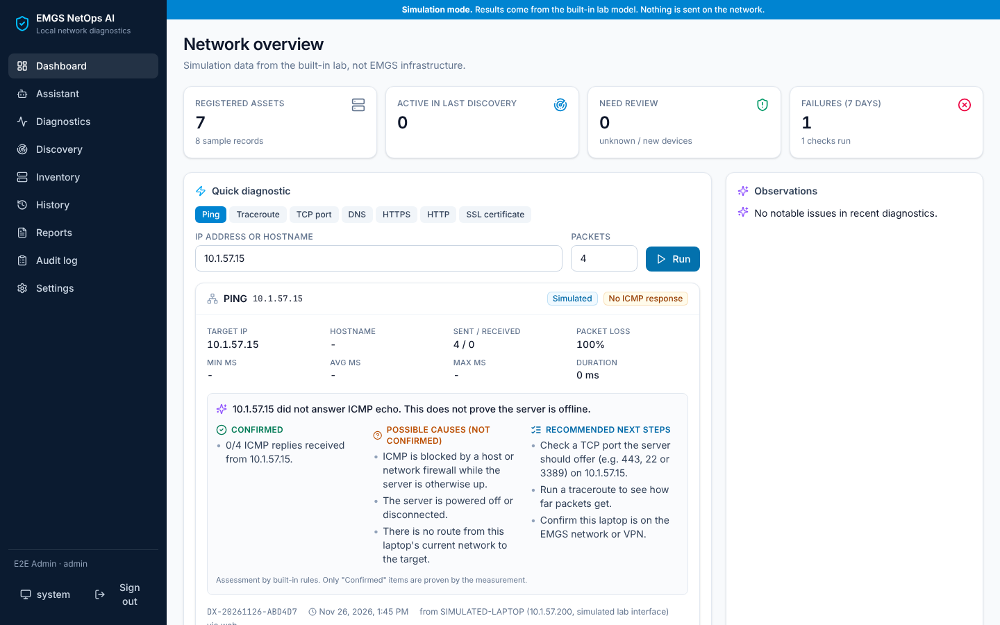
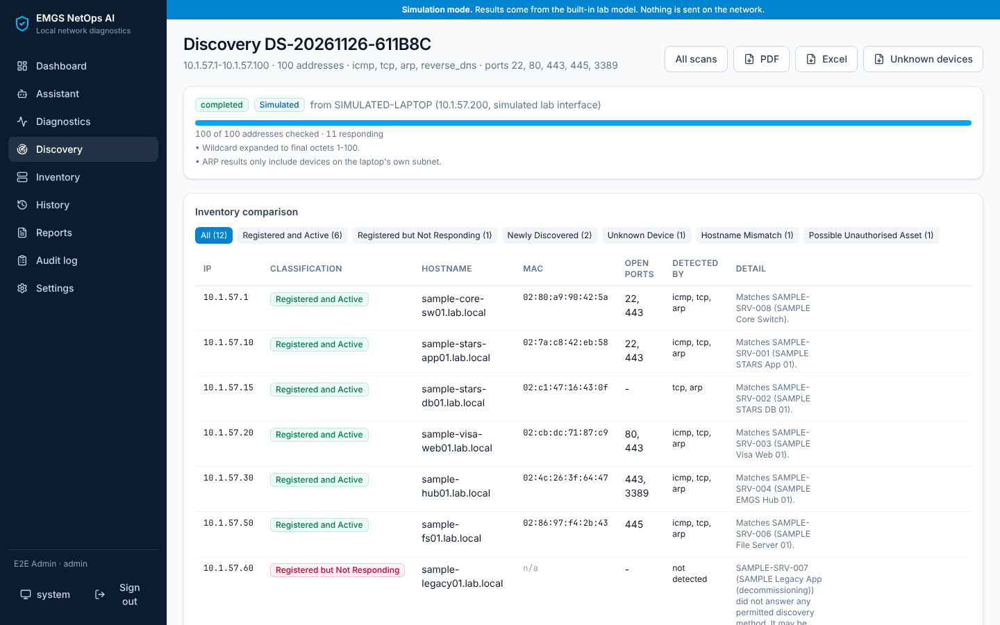
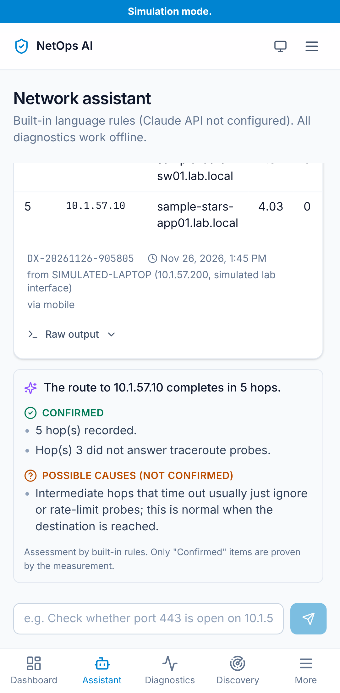

# EMGS NetOps AI

A local-first network diagnostics, discovery and infrastructure intelligence platform. It runs entirely on the user's
laptop. Diagnostics run from the laptop's current network connection and are available from:

* the **web dashboard** at `http://127.0.0.1:8750` (responsive, light/dark),
* a **mobile browser** over a private VPN / Tailscale / office Wi-Fi connection (HTTPS, signed-in sessions),
* **Claude Code** through an MCP server, and **Codex** through MCP or a JSON CLI.

There is no server, cloud deployment or paid monitoring subscription. The Claude API is optional; every diagnostic,
discovery, report and the assistant's built-in language rules work without it.

| Dashboard | Discovery | Mobile |
|---|---|---|
|  |  |  |

## Features

| Area | What it does |
|---|---|
| Diagnostics | Ping, traceroute/tracert, TCP port checks (single, multiple, all approved), DNS (A, AAAA, CNAME, MX, NS, TXT, PTR), HTTP/HTTPS (status, redirects, TLS), SSL certificates (issuer, validity, days left, hostname match) |
| Discovery | Ranges as `10.1.57.10`, `10.1.57.xx`, `10.1.57.0/24` or `10.1.57.1-10.1.57.254`. Plan → confirm → ICMP + TCP + ARP + reverse DNS (+ optional Nmap / authorised OS fingerprinting). Progress, pause, resume, cancel, concurrency and rate limits, history and change tracking |
| Inventory | Server register with owners, criticality and approved ports. Excel import/export, search, deactivate, delete with confirmation, register discovered devices |
| Comparison | Registered and Active · Registered but Not Responding · Newly Discovered · Unknown Device · Duplicate IP Conflict · Hostname Mismatch · Possible Unauthorised Asset (flagged for review, never presented as an accusation) |
| AI assistant | Natural-language requests; asks for missing information; separates **confirmed** results from **possible causes** and **recommendations**; never presents a firewall as confirmed without evidence. Optional Claude (`claude-opus-5-5`) for interpretation and explanations |
| Reports | 9 report types in Excel and PDF with reference, time, user, source interface, destination, methodology, raw results, assessment and recommendations |
| Security | Local accounts (scrypt), sessions with CSRF, roles (admin/operator/viewer), API tokens, target/port allowlists, input validation, no shell execution, timeouts, rate limits, audit trail, encrypted API key, backup/restore, retention |
| Modes | **Simulation** (built-in lab, no network traffic) · **Live** (real diagnostics) · **Review** (read-only, offline) |

## Quick start

```bash
./start_netops.sh          # Linux / macOS
start_netops.bat           # Windows
```

Then open http://127.0.0.1:8750, create the local administrator, and explore in **Simulation mode**. Before switching to
**Live** mode on the EMGS network, add the authorised ranges, domains and ports under *Settings > Approved targets*.
Stop with `./stop_netops.sh` / `stop_netops.bat`.

Requirements: Python 3.11+, Node.js 20+ (first build only). On Linux, also `ping` and `traceroute`/`tracepath`. Nmap is optional.

## Project layout

```
backend/        FastAPI app (api, core, database, models, schemas, services, diagnostics, discovery,
                security, ai, reports) and pytest suite
frontend/       React + TypeScript + Vite + Tailwind dashboard, Vitest and Playwright tests
mcp-server/     MCP server for Claude Code / Codex (tools/ holds the shared tool functions)
scripts/        startup launcher, CLI (netops_cli.py), backup, environment check
desktop/        desktop shortcut helpers
data/           database, reports, backups (created at runtime, git-ignored)
docs/           architecture, ERD, API, MCP, security, user guide, deployment, testing
```

## Documentation

* [Architecture](docs/architecture/architecture.md) · [Database ERD](docs/architecture/database-erd.md)
* [REST/WebSocket API](docs/api/api-specification.md) · [MCP & Codex](docs/api/mcp-specification.md)
* [Security design](docs/security/security-design.md)
* [Installation](docs/deployment/installation.md) · [Mobile access](docs/deployment/mobile-access.md) · [Testing](docs/deployment/testing.md)
* [User guide](docs/user-guide/user-guide.md)

## Tests

```bash
cd backend && ../.venv/bin/python -m pytest -q        # 103 tests
cd frontend && npm test                               # 18 tests
cd frontend && npx playwright test --trace off        # 7 end-to-end tests (desktop + phone)
```

## Sample data

The seeded inventory (`SAMPLE-SRV-…`), the `10.1.57.0/24` lab network and the `emgs.com.my` domain entry are **sample
data**. They are labelled everywhere, apply only in Simulation mode, and are **not** real EMGS infrastructure records.
